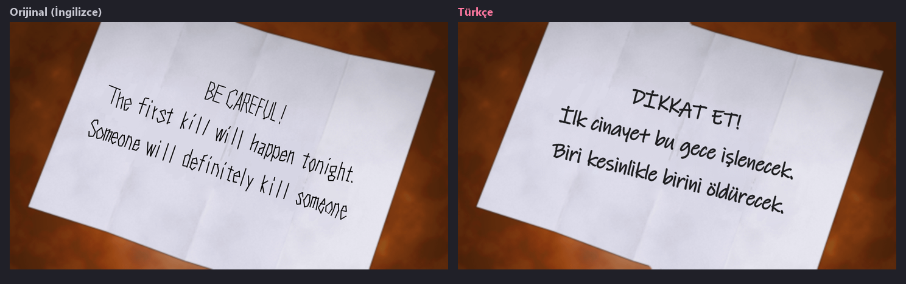
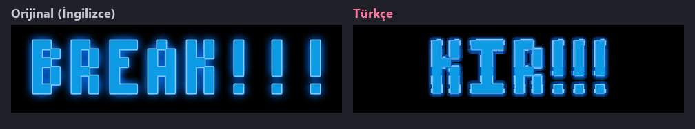
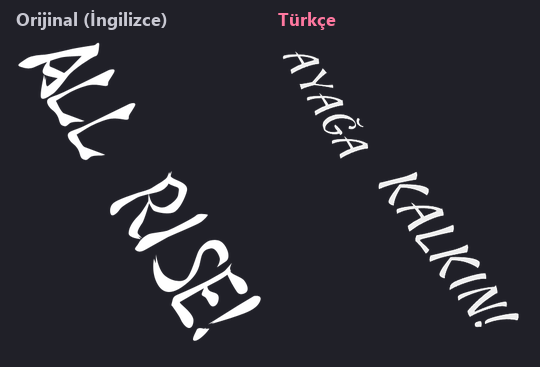
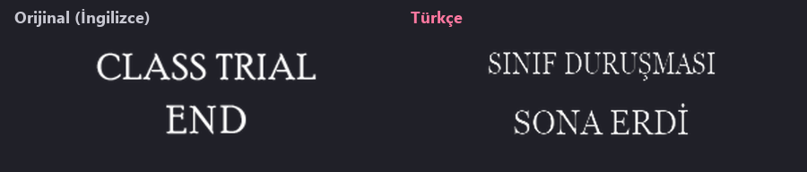
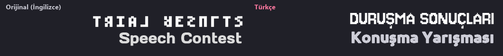
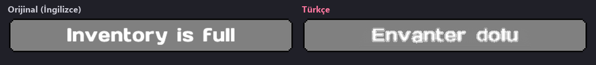
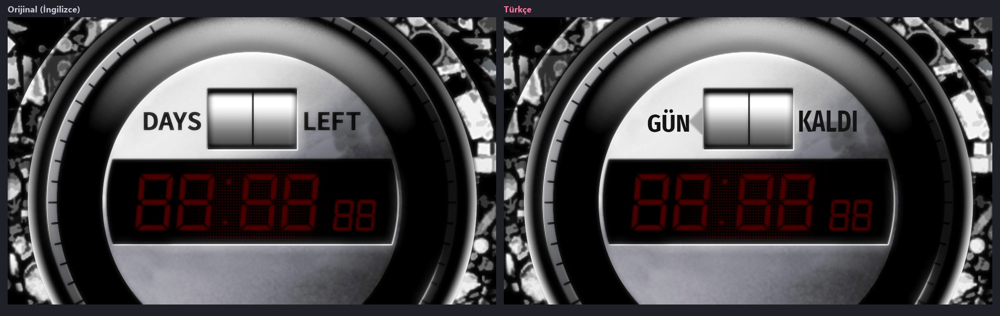
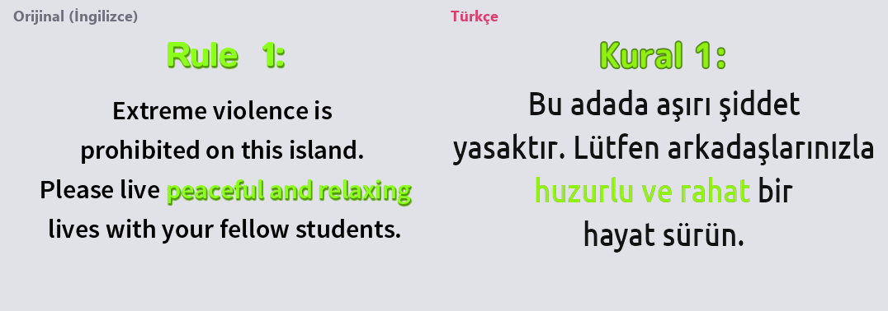

# Danganronpa 2: Goodbye Despair – Turkish Patch

[🇹🇷 Türkçe](README.md) | 🇬🇧 English

A free, unofficial Turkish translation patch for **Danganronpa 2: Goodbye Despair** (Steam / PC).

> ⚠️ This patch is **free**. If you paid for it anywhere, you have been scammed. The only official download location is this page: **https://github.com/Utkucan-W**
> Selling this patch, or including it in any paid product or service, is **not allowed** (see [License](#license)).

## Features

- **All dialogue in Turkish:** the main story, Free Time events, Class Trials, Island Mode and the *Danganronpa IF* novel.
- **Context-aware translation:** lines are written for the scene and the character, not translated word for word. Terminology is consistent throughout the game (Class Trial, Truth Bullet, Ultimate …, Case, Execution, etc.).
- **Fits the dialogue box:** lines are wrapped to fit the in-game text box, with no cut-off sentences. Coloured highlights and button icons are preserved.
- **Over 2,000 images translated:** titles, menus, trial screens, notes and handwriting, redrawn to match the original lettering style, colour, angle and position.
- **Easy install and uninstall:** one click to install, automatic backup, revert to the original at any time.

## Screenshots

Left: original (English), right: Turkish.

**Class Trial**

**Interface**

## Installation

1. Make sure the **Steam version** of the game is installed and unmodified (English).
   If you installed another patch before, right-click the game in Steam → **Properties → Installed Files → Verify integrity of game files**.
2. Download the latest `.zip` from the [Releases](../../releases) page and extract it to a folder.
3. Double-click **`KUR.bat`** (install).
   The game folder is detected automatically. If it is not found, drag the game folder into the window and press Enter.
4. Start the game. Enjoy!

**To uninstall:** run `KALDIR.bat`, or use "Verify integrity of game files" in Steam.

> The installer backs up the original files to the `turkce_yama_yedek` folder inside the game folder. The patch only contains differences; no game files are distributed, and you need your own legitimate copy of the game for it to work.

## FAQ

- **I get an "orijinal İngilizce dosya değil" (not the original English file) error.** Your game files have been modified. Delete the `turkce_yama_yedek` folder, verify the game files in Steam, and run `KUR.bat` again.
- **The game was updated and the patch broke.** Verify the game files in Steam and install the latest version of the patch.
- **I found a wrong or odd line.** Report it on the [Issues](../../issues) page with the scene and the line.

## License

The patch content is licensed under **[CC BY-NC-SA 4.0](https://creativecommons.org/licenses/by-nc-sa/4.0/)** (details in [LICENSE.md](LICENSE.md)):

- ✅ You may share it for free, but you must credit the source (this page).
- ❌ **Commercial use is prohibited.** It may not be sold or included in any paid package or service.
- 🔁 Modified versions must be shared under the same license, with credit.

*Danganronpa 2: Goodbye Despair* and all related trademarks, images and content are the property of **Spike Chunsoft Co., Ltd.** This project is unofficial and is not affiliated with Spike Chunsoft or NIS America. Please buy the game on [Steam](https://store.steampowered.com/app/413420/).

The installer uses [xdelta3](https://github.com/jmacd/xdelta) (GPLv2).

---

Made by **[Utkucan-W](https://github.com/Utkucan-W)**
