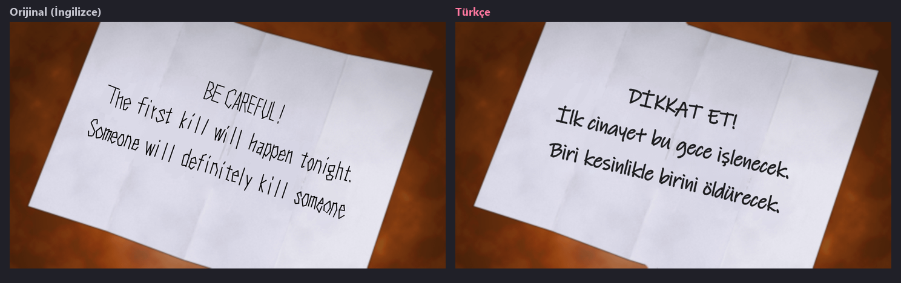
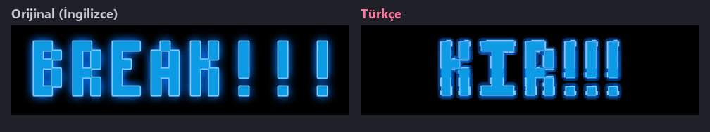
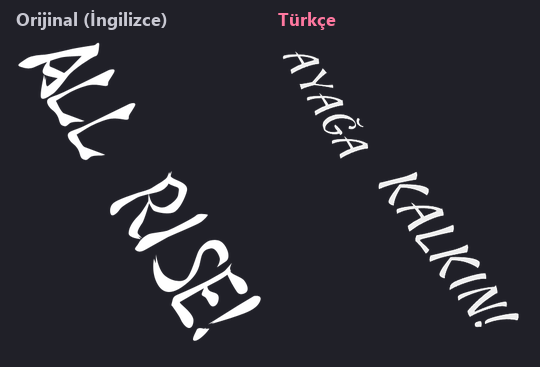
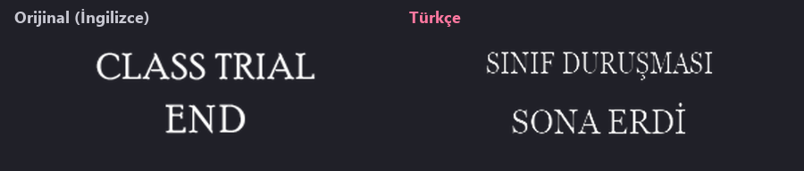
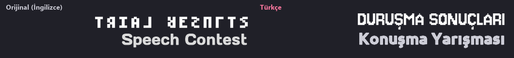
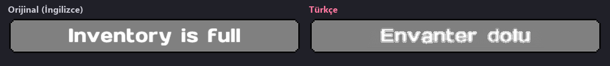
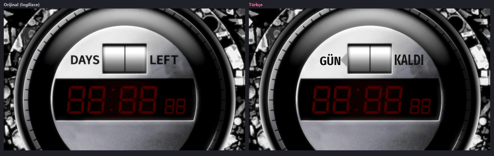
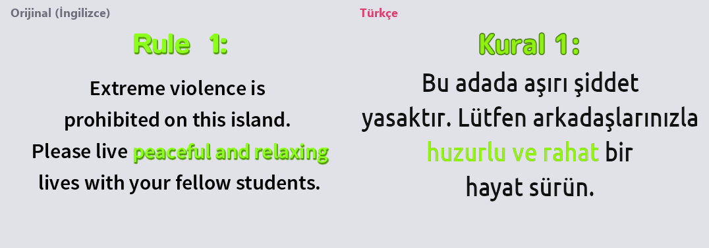

# Danganronpa 2: Goodbye Despair – Türkçe Yama

**Danganronpa 2: Goodbye Despair** (Steam / PC) için ücretsiz, gayriresmî Türkçe yama.

> ⚠️ Bu yama **ücretsizdir**. Bu yamayı herhangi bir yerde **ücretli** satın aldıysanız dolandırılmışsınız demektir. Resmî ve tek indirme adresi bu sayfadır: **https://github.com/Utkucan-W**

## Özellikler

- **Tüm diyaloglar Türkçe:** ana hikâye, serbest zaman olayları, duruşmalar, Island Mode ve *Danganronpa IF* romanı.
- **Bağlama uygun çeviri:** cümleler sahneye ve karaktere göre yazıldı, kelimesi kelimesine çeviriden kaçınıldı. Terimler oyun boyunca tutarlı (Sınıf Duruşması, Gerçek Mermisi, Nihai …, Dava, İdam vb.).
- **Konuşma kutusuna uygun metin:** satırlar oyunun kutusuna sığacak şekilde bölündü, yarıda kesilen cümle yok. Renkli vurgular ve kontrol tuşu simgeleri korundu.
- **2.000'den fazla görsel Türkçeleştirildi:** başlıklar, menüler, duruşma ekranları, notlar ve el yazıları. Orijinal yazının stiline (fırça, el yazısı, piksel yazı), rengine, açısına ve konumuna uygun şekilde yeniden çizildi.
- **Kolay kurulum ve kaldırma:** tek tıkla kurulur, otomatik yedek alır, istediğiniz zaman orijinale dönersiniz.

## Ekran görüntüleri

Solda orijinal (İngilizce), sağda Türkçe.

**Duruşma**

**Arayüz**

## Kurulum

1. Oyunun **Steam sürümünün** kurulu ve orijinal (İngilizce) hâlde olduğundan emin olun.
   Daha önce başka bir yama kurduysanız önce Steam'de oyuna sağ tıklayın → **Özellikler → Yüklü Dosyalar → Oyun dosyalarının bütünlüğünü doğrula**.
2. [Releases](../../releases) sayfasından son sürümün `.zip` dosyasını indirin ve bir klasöre çıkarın.
3. **`KUR.bat`** dosyasına çift tıklayın.
   Oyun klasörü otomatik bulunur. Bulunamazsa oyun klasörünü pencereye sürükleyip Enter'a basın.
4. Oyunu başlatın. İyi oyunlar!

**Kaldırmak için:** `KALDIR.bat` dosyasını çalıştırın. Ya da Steam'de "Oyun dosyalarının bütünlüğünü doğrula" seçeneğini kullanın.

> Kurulum, orijinal dosyaları oyun klasöründeki `turkce_yama_yedek` klasörüne yedekler. Yama yalnızca farkları içerir; oyun dosyası dağıtılmaz, yamanın çalışması için oyunun size ait orijinal bir kopyası gerekir.

## Sık sorulanlar

- **"Orijinal İngilizce dosya değil" hatası alıyorum.** Oyun dosyaları değiştirilmiş demektir. `turkce_yama_yedek` klasörünü silin, Steam'den dosya bütünlüğünü doğrulayın ve `KUR.bat`'ı tekrar çalıştırın.
- **Oyun güncellendi, yama bozuldu.** Steam'den dosyaları doğrulayın ve yamanın en güncel sürümünü kurun.
- **Hatalı veya tuhaf bir cümle gördüm.** [Issues](../../issues) sayfasından sahneyi ve cümleyi yazarak bildirin.

## Lisans

Yamanın içeriği **[CC BY-NC-SA 4.0](https://creativecommons.org/licenses/by-nc-sa/4.0/deed.tr)** ile lisanslanmıştır (ayrıntılar için [LICENSE.md](LICENSE.md)):

- ✅ Ücretsiz paylaşabilirsiniz, ancak kaynak (bu sayfa) belirtilmelidir.
- ❌ **Ticari kullanım yasaktır.** Satılamaz, ücretli paketlere veya hizmetlere konulamaz.
- 🔁 Değiştirilmiş sürümler de aynı lisansla ve kaynak belirtilerek paylaşılmalıdır.

*Danganronpa 2: Goodbye Despair* ve ilgili tüm marka, görsel ve içeriklerin hakları **Spike Chunsoft Co., Ltd.**'ye aittir. Bu proje resmî değildir ve Spike Chunsoft veya NIS America ile bir bağlantısı yoktur. Oyunu lütfen [Steam](https://store.steampowered.com/app/413420/)'den satın alın.

Kurulum aracı [xdelta3](https://github.com/jmacd/xdelta) (GPLv2) kullanır.

---

Hazırlayan: **[Utkucan-W](https://github.com/Utkucan-W)**
